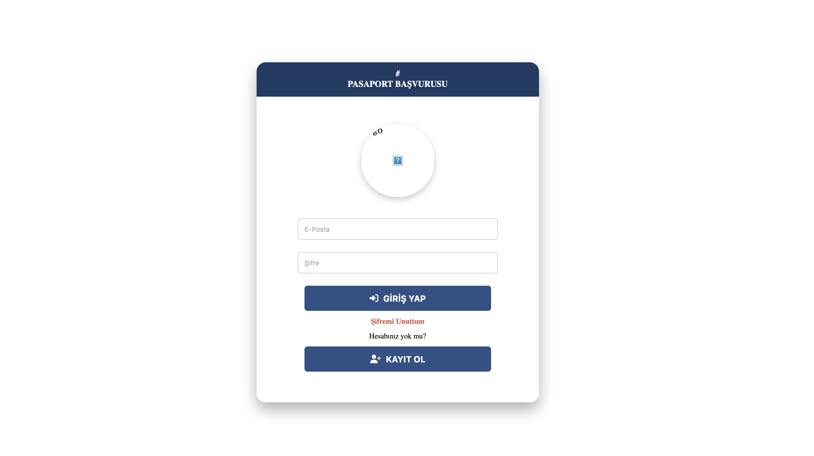

# Pasaport Başvuru ve Takip Sistemi

Üniversite personelinin hususi ve hizmet pasaportu başvurularını çevrimiçi yapabildiği, yetkililerin başvuruları inceleyip onaylayabildiği web tabanlı bir başvuru takip sistemi. Başvuru sürecini dijital ve takip edilebilir hale getirmek için tasarlandı.

> Bir üniversitenin Dijital Dönüşüm Ofisi'ndeki çalışmam sırasında (2025) PHP ve MySQL ile geliştirdim.



## Nasıl Çalışır?

```
Personel                                  Yetkili
────────                                  ───────
Kayıt ol / giriş yap                      Giriş yap (rol = 1)
        │                                         │
Başvuru formu                             Bekleyen başvurular
 • pasaport türü, kadro, unvan                    │
 • kimlik fotokopisi                       İncele → Onayla / Reddet (+ not)
 • eş ve çocuk belgeleri                          │
        │                                         ▼
        └──────── Süreç: Bekliyor ──► Onaylandı / Reddedildi
                                  │
                   Personel kendi panelinden durumu ve notu görür
```

## Özellikler

- **Rol tabanlı erişim:** Personel (rol 0) ve yetkili (rol 1) için ayrı paneller
- **Başvuru formu:** Hususi / Hizmet pasaportu, kadro ve unvan bilgileri, belge yükleme
- **Aile bireyleri:** Eş ve sayısı kadar çocuk için dinamik belge alanları
- **Süreç takibi:** Bekliyor → Onaylandı / Reddedildi, yetkili notuyla birlikte
- **Yetkili araçları:** Bekleyen ve sonuçlanan başvuru listeleri, kullanıcıların fakülte ve görev bilgilerini güncelleme

## Güvenlik

Sistem kimlik belgesi ve TC numarası gibi hassas veriler işlediği için güvenlik öncelikliydi.

| Risk | Önlem |
| --- | --- |
| SQL injection | Tüm sorgular prepared statement ile çalışır; güncellenebilir sütun adları beyaz listeden geçer |
| Şifre sızıntısı | Şifreler `password_hash` (bcrypt) ile saklanır |
| Yetkisiz erişim | Korumalı her sayfada oturum ve rol kontrolü vardır; kişisel verileri listeleyen sayfalar ve API'ler yalnızca yetkiliye açıktır |
| Hesap ele geçirme | Şifre sıfırlamada e-posta ile birlikte TC kimlik numarası da doğrulanır |
| Zararlı dosya yükleme | Yalnızca JPG, PNG ve PDF (en fazla 5 MB); MIME türü kontrol edilir; dosyalar rastgele adla kaydedilir; `uploads/` klasöründe script çalıştırma kapalıdır |
| Bilgi sızıntısı | Veritabanı hata ayrıntıları kullanıcıya gösterilmez |

**Gerçek bir kurulum için bilinen sınırlamalar:**
- Şifre sıfırlama, e-postaya gönderilen tek kullanımlık bir bağlantıyla yapılmalıdır.
- Kimlik belgeleri web kök dizininin dışında saklanmalı ve yalnızca yetkiliye bir PHP dosyası üzerinden sunulmalıdır.
- Formlar CSRF token ile korunmalıdır.

## Veritabanı

`database.sql` dosyası şemayı ve **örnek** verileri içerir. Tüm kişi bilgileri uydurmadır.

| Tablo | İçerik |
| --- | --- |
| `users` | Kullanıcılar: ad, e-posta, şifre (hash), TC, telefon, fakülte, görev, rol |
| `applications` | Başvurular: pasaport türü, kadro, unvan, belgeler, süreç durumu, yetkili notu |
| `cocuklar` | Başvuruya bağlı çocuk kimlik belgeleri |
| `admins` | Yetkili kayıtları |

İlişkiler: `applications.user_id → users.id`, `cocuklar.application_id → applications.id`. Silme işlemi bağlı kayıtları da siler (`ON DELETE CASCADE`).

## Kurulum

1. [XAMPP](https://www.apachefriends.org/) kurun, Apache ve MySQL'i başlatın.
2. Proje klasörünü `htdocs/pasaport` altına kopyalayın.
3. phpMyAdmin'de **İçe Aktar** ile `database.sql` dosyasını yükleyin. Veritabanı otomatik olarak oluşturulur.
4. `http://localhost/pasaport/` adresini açın.

**Demo hesaplar:**

| Rol | E-posta | Şifre |
| --- | --- | --- |
| Yetkili | `yetkili@ornek.com` | `admin1234` |
| Personel | `kullanici@ornek.com` | `demo1234` |

## Dosya Yapısı

| Dosya | Görevi |
| --- | --- |
| `index.php`, `giris.php` | Giriş ekranı ve doğrulama |
| `kayit.php`, `register.php` | Kayıt formu ve işleme |
| `sifre.php` | Şifre sıfırlama |
| `kullanicisayfa.php` | Personel paneli: başvuru durumu |
| `basvuruyapsayfa.php`, `submit_application.php` | Başvuru formu ve kaydı |
| `yetkilisayfa.php` | Yetkili paneli: bekleyen başvurular |
| `update_application.php` | Başvuruyu onaylama / reddetme |
| `sonuclananbasvuru.php` | Sonuçlanan başvurular |
| `kisibilgileri.php` | Başvuru detayları |
| `yetkilendirme.php`, `update_user.php` | Kullanıcı listesi ve bilgi güncelleme (JSON API) |
| `db.php` | Veritabanı bağlantısı |

**Teknolojiler:** PHP 8 (procedural), MySQL/MariaDB, HTML, CSS, JavaScript

## Geliştirici

**Emine Yaren Almas** · [GitHub](https://github.com/yarenalms) · [LinkedIn](https://www.linkedin.com/in/yaren-almas-4280a3233) · [curtstudio.netlify.app](https://curtstudio.netlify.app)
